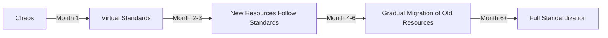

# Kubitor: The Multi-Cluster Standardization Platform

## The Universal Problem

Every organization with 10+ Kubernetes clusters faces the same nightmare:
- **Different IaC patterns**: Terraform here, Helm there, kubectl apply somewhere else
- **Inconsistent folder structures**: Each team organizes differently
- **Tag chaos**: Different naming conventions, missing tags, no enforcement
- **No unified visibility**: Can't answer "what's running where?"
- **Compliance impossibility**: Manual audits across diverse patterns

## The Kubitor Solution: Virtual Standardization Layer

### Core Innovation
**"Create standardization without forcing migration"**

Kubitor introduces a **Virtual Standardization Layer** that sits above your chaos and provides unified governance, visibility, and compliance - regardless of how resources were deployed.

## Key Features for Multi-Cluster Standardization

### 1. Pattern Detection & Classification

Kubitor automatically discovers and classifies deployment patterns across all clusters:

```yaml
Pattern Analysis Report
═══════════════════════
Deployment Methods Found:
├── Terraform Modules:
│   ├── eks-module v2.3.1 (12 clusters)
│   ├── eks-module v1.8.2 (5 clusters)
│   └── custom-k8s-module (3 clusters)
├── Helm Charts:
│   ├── Standard Charts (15 clusters)
│   └── Custom Charts (8 clusters)
├── GitOps:
│   ├── ArgoCD (4 clusters)
│   └── Flux (2 clusters)
└── Manual Deployments (7 clusters)

Folder Structure Patterns:
├── Pattern A: /terraform/env/{env}/k8s (40%)
├── Pattern B: /k8s/{cluster-name}/ (30%)
├── Pattern C: /infra/kubernetes/{region} (20%)
└── Chaos: No consistent pattern (10%)
```

### 2. Virtual Tagging Engine

The magic: Kubitor adds a virtual governance layer WITHOUT modifying actual resources:

```python
# Virtual Tagging Rules
virtual_tags:
  - rule: "Infer team from namespace"
    when: "namespace.startswith('team-')"
    set: "team = namespace.split('-')[1]"
    
  - rule: "Derive cost center from cluster"
    when: "cluster.name.contains('prod')"
    set: "cost-center = 'PROD-001'"
    
  - rule: "Auto-classify by path pattern"
    when: "source.path.contains('/payments/')"
    set: "service-group = 'payments'"
```

**Result**: Instant standardization without touching IaC:
```bash
$ kubitor query "team=payments"
# Returns resources across ALL clusters, regardless of actual tagging
```

### 3. Unified Inventory Across Chaos

```bash
$ kubitor inventory --unified

Unified Kubernetes Inventory
════════════════════════════

Total Clusters: 34 (EKS: 26, AKS: 6, GKE: 2)
Total Resources: 12,847
Deployment Patterns: 7 different

Standardization Coverage:
├── Has Team Tag (actual): 34%
├── Has Team Tag (virtual): 94% ✅
├── Has Cost Center (actual): 12%
├── Has Cost Center (virtual): 87% ✅
├── Follows Naming Convention: 45%
├── Can Be Mapped to Standard: 92% ✅
```

### 4. Progressive Standardization Workflow

Instead of forcing big-bang migrations, Kubitor enables gradual convergence:



#### Stage 1: Virtual Standardization (Immediate)
```bash
# Apply virtual standards without changing anything
kubitor apply-virtual-standards --all-clusters

✅ Virtual standards applied
   - 12,847 resources now have virtual tags
   - Cost allocation now possible
   - Compliance reporting enabled
```

#### Stage 2: Enforce for New Resources (Month 1)
```bash
# Admission webhook prevents non-compliant resources
kubitor install-admission-controller --mode=new-resources-only

⚠️  New resources must have:
   - team tag
   - cost-center tag
   - standard naming convention
```

#### Stage 3: Automated Migration Assistance (Months 2-6)
```bash
# Generate IaC patches for gradual migration
kubitor generate-migration --cluster=prod-cluster-1

Generated migrations:
├── terraform/: 45 files need tag additions
├── helm/: 12 values.yaml need updates
├── manifests/: 78 YAML files need patches

Apply with: kubitor migrate --dry-run
```

### 5. Multi-Pattern Reconciliation

Kubitor understands that different patterns can achieve the same goal:

```yaml
# Reconciliation Rules
reconciliation:
  ingress:
    patterns:
      - nginx-ingress-controller
      - aws-load-balancer-controller
      - traefik
    standardize_to: "ingress-abstract"
    
  monitoring:
    patterns:
      - prometheus-operator
      - datadog-agent
      - new-relic-agent
    standardize_to: "monitoring-abstract"
```

This creates a unified view despite different implementations:
```bash
$ kubitor report --abstract

Service Exposure (Abstract View):
├── HTTP Ingress: 234 services
│   ├── via nginx: 123
│   ├── via ALB: 89
│   └── via traefik: 22
└── All follow standard patterns ✅
```

### 6. Compliance Without Conformity

Different teams can maintain their workflows while meeting compliance:

```yaml
compliance_rules:
  sox:
    required_tags: [owner, data-classification, cost-center]
    required_policies: [network-policy, pod-security-policy]
    audit_logging: enabled
    
  # Kubitor validates compliance regardless of how it's achieved
  validation_mode: "outcome-based"  # Not "implementation-based"
```

```bash
$ kubitor compliance-check --standard=sox

SOX Compliance Report
════════════════════
Compliant Clusters: 28/34 (82%)

Non-Compliant:
├── eks-sandbox-1: Missing audit logging
├── aks-dev-2: No network policies
└── gke-test-1: Missing required tags

Note: All achieved compliance differently (Terraform: 18, Helm: 8, GitOps: 2)
```

### 7. Intelligence Layer

Kubitor learns from your patterns and makes smart suggestions:

```bash
$ kubitor analyze --suggest-standards

Pattern Analysis Complete
════════════════════════

Recommended Standards (based on your usage):
1. Naming: {env}-{region}-{service} (used by 67% of well-maintained resources)
2. Tagging: team, cost-center, env (present in 80% of production resources)
3. Structure: /k8s/{env}/{service}/ (most common successful pattern)

Anti-patterns Detected:
- 5 clusters using deprecated ingress.extensions/v1beta1
- 12 clusters with no resource limits
- 8 clusters mixing Helm v2 and v3

Suggested Convergence Path:
1. Standardize on Terraform module eks-v2 (18 clusters already use it)
2. Migrate from Helm v2 to v3 (affects 3 clusters)
3. Consolidate ingress controllers (reduce from 3 to 1)
```

### 8. The Migration Assistant

For teams ready to standardize their IaC:

```bash
$ kubitor migrate-assistant --source=chaos --target=standard

Migration Assistant
═══════════════════

Analyzing cluster: eks-prod-1
Current State:
├── IaC Pattern: Mixed (Terraform 60%, Helm 30%, Manual 10%)
├── Folder Structure: /random/places/k8s/
├── Tag Compliance: 23%

Proposed Migration:
├── Target Pattern: Terraform eks-module v2
├── New Structure: /k8s/prod/us-east-1/
├── Auto-generated tags: 94% compliance

Generated:
├── Migration script: ./migrations/eks-prod-1/migrate.sh
├── Terraform configs: ./migrations/eks-prod-1/terraform/
├── Rollback plan: ./migrations/eks-prod-1/rollback.sh
├── Risk assessment: LOW (most resources already in Terraform)

Ready to proceed? Run: kubitor migrate --execute eks-prod-1
```

## Implementation Strategy

### Phase 1: Discovery (Week 1)
```bash
# One command to understand your chaos
kubitor discover --all-clusters --analyze-patterns
```

### Phase 2: Virtual Standards (Week 2)
```bash
# Instant standardization without changes
kubitor create-virtual-standards --auto-detect
kubitor apply-virtual-standards --all-clusters
```

### Phase 3: Governance (Week 3-4)
```bash
# Start enforcing for new resources
kubitor enable-governance --mode=progressive
```

### Phase 4: Migration (Months 2-6)
```bash
# Gradual, assisted migration
kubitor migration-plan --generate-all
kubitor migrate --cluster=<cluster> --verify
```

## The Magic Formula

1. **No Forced Migrations**: Teams keep their IaC patterns
2. **Instant Visibility**: Virtual layer provides immediate standardization
3. **Progressive Enhancement**: Gradually improve without disruption
4. **Pattern Agnostic**: Works with Terraform, Helm, GitOps, or manual
5. **Intelligence Driven**: Learns from your patterns, suggests improvements

## ROI Metrics

### Immediate (Day 1)
- 100% visibility across all clusters
- Virtual standardization enables cost allocation
- Compliance reporting without changes

### Short-term (Month 1)
- 90%+ virtual tag coverage
- Automated compliance validation
- Cross-cluster resource search

### Medium-term (3 Months)  
- 50% reduction in configuration drift
- 75% of new resources follow standards
- 10x faster audit reports

### Long-term (6 Months)
- 80%+ actual standardization
- 90% reduction in manual compliance work
- Full cost attribution and optimization

## Why This Works

Traditional approaches fail because they require:
- ❌ Massive migrations
- ❌ Teams changing their workflows
- ❌ Standardizing on one tool
- ❌ Big-bang cutovers

Kubitor succeeds because it:
- ✅ Provides value immediately
- ✅ Works with existing patterns
- ✅ Enables gradual improvement
- ✅ Respects team autonomy
- ✅ Focuses on outcomes, not methods

---

**Kubitor: Standardization Without Migration**

*Your clusters. Your patterns. Our governance.*