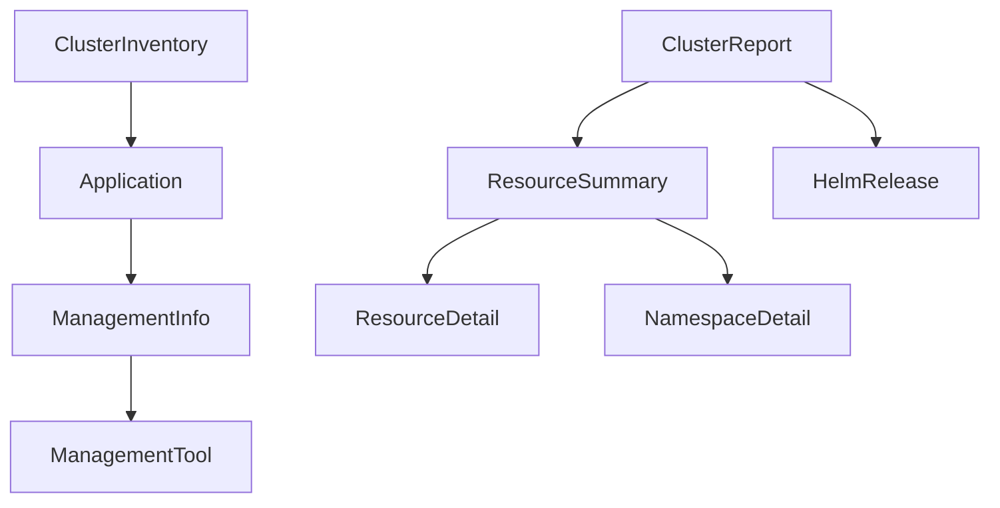

# Kubitor Model Organization

All data models in Kubitor are organized under the `src/model/` directory following a consistent pattern. This document describes the model structure and organization.

## Model Directory Structure

```
src/model/
├── __init__.py           # Main model exports
├── annotations.py        # Annotation filtering models
├── cluster.py           # Cluster information models
├── database.py          # Database record models
├── export.py            # Export format enums
├── inventory.py         # Inventory models (Application, ClusterInventory)
├── kubernetes.py        # Kubernetes resource models
├── management.py        # Management detection models
└── report.py            # Reporting models
```

## Model Categories

### Core Kubernetes Models (`kubernetes.py`)
- `K8sResource` - Represents a Kubernetes resource
- `ResourceType` - Metadata about resource types

### Cluster Models (`cluster.py`)
- `ClusterInfo` - Cluster-level information
- `NodeInfo` - Kubernetes node information
- `ClusterVersion` - Version information
- `UpgradeSuggestion` - Upgrade recommendations

### Inventory Models (`inventory.py`)
- `Application` - Represents a deployed application
- `ClusterInventory` - Complete cluster inventory snapshot

### Management Models (`management.py`)
- `ManagementTool` - Enum of management tools (Helm, ArgoCD, Flux, etc.)
- `ManagementInfo` - Details about how a resource is managed

### Report Models (`report.py`)
- `ClusterReport` - Complete cluster report
- `ResourceSummary` - Resource statistics
- `HelmRelease` - Helm release information
- `HelmRepository` - Helm repository information
- `ResourceDetail` - Detailed resource information
- `NamespaceDetail` - Namespace-level details

### Database Models (`database.py`)
- `ScanRecord` - Historical scan records
- `ResourceChange` - Change tracking records
- `HistoricalSummary` - Historical statistics

### Export Models (`export.py`)
- `ExportFormat` - Output format options (YAML, JSON)
- `OrganizeBy` - Organization strategies
- `ReportFormat` - Report format options

### Annotation Models (`annotations.py`)
- `AnnotationFilter` - Filter criteria for annotations
- `AnnotationConfig` - Company-specific annotation configuration

## Model Design Principles

1. **Single Responsibility**: Each model file contains related models for a specific domain
2. **Type Safety**: All models use type hints for better IDE support and validation
3. **Pydantic/Dataclass**: Models use either Pydantic BaseModel or Python dataclasses
4. **Clear Imports**: Models are exported through `__init__.py` for clean imports

## Usage Examples

### Importing Models

```python
# Import from model package
from src.model import ClusterInventory, Application, ManagementTool

# Import from specific modules
from src.model.inventory import Application
from src.model.management import ManagementTool, ManagementInfo
```

### Creating Model Instances

```python
# Create an application instance
app = Application(
    name="nginx",
    namespace="production",
    kind="Deployment",
    version="1.21.0",
    replicas=3
)

# Create inventory
inventory = ClusterInventory(
    cluster_name="production-eks",
    kubernetes_version="v1.28.0",
    node_count=5,
    scan_timestamp=datetime.now(),
    applications=[app]
)
```

## Model Relationships



## Best Practices

1. **Keep Models Pure**: Models should not contain business logic, only data structure
2. **Use Type Hints**: Always specify types for model fields
3. **Document Fields**: Add docstrings for complex fields
4. **Avoid Circular Imports**: Use TYPE_CHECKING for forward references
5. **Consistent Naming**: Use clear, descriptive names for models and fields

## Adding New Models

When adding new models:

1. Create the model in the appropriate file under `src/model/`
2. If needed, create a new model file for a new domain
3. Export the model in `src/model/__init__.py`
4. Add type hints and documentation
5. Write tests for model validation

## Migration Notes

Previously, some models were scattered in the core modules. They have been reorganized:
- `Application`, `ClusterInventory` moved from `src/core/inventory.py` to `src/model/inventory.py`
- `ManagementTool`, `ManagementInfo` moved from `src/core/management_detector.py` to `src/model/management.py`

This ensures all data models follow the consistent `src/model/` pattern.